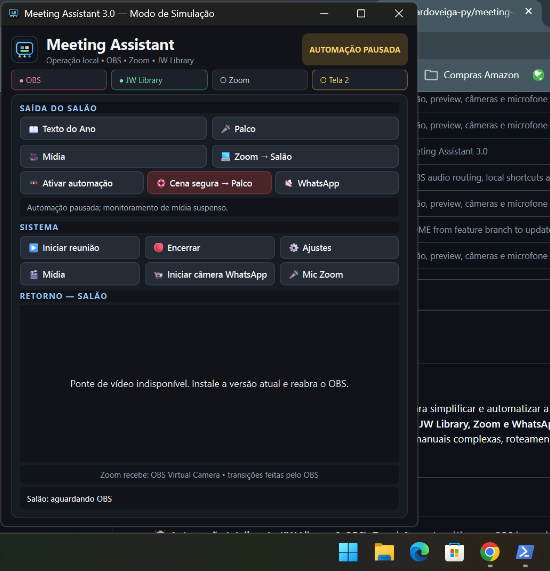
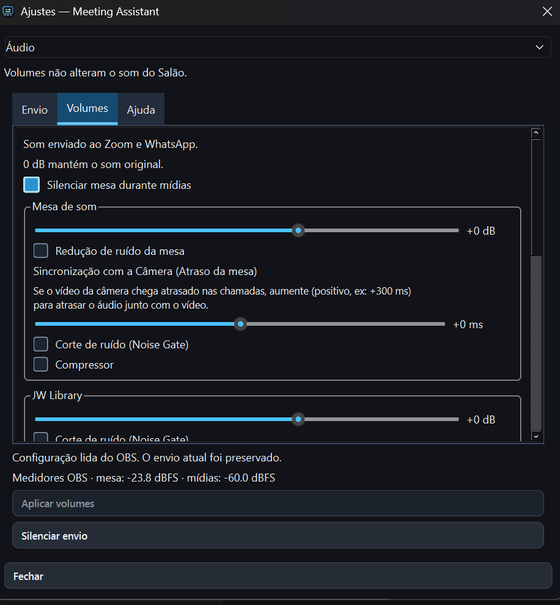
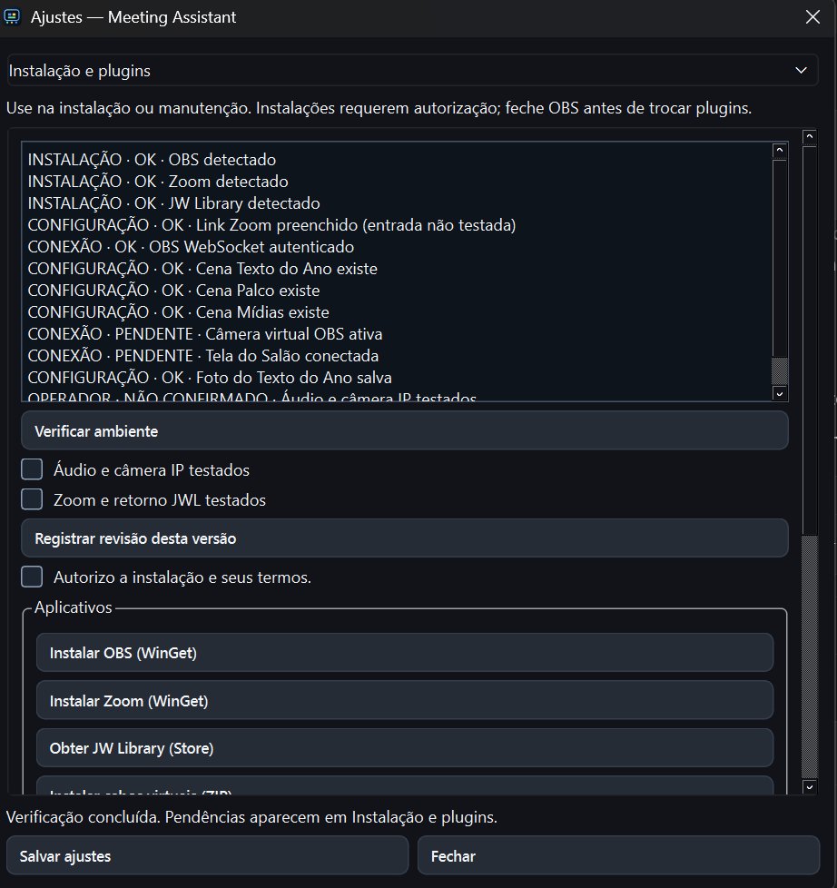
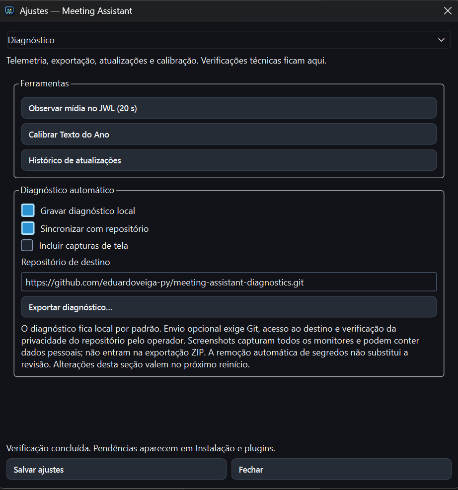

# 🖥️ Meeting Assistant


O **Meeting Assistant** é um orquestrador open-source criado para simplificar e automatizar a operação de áudio e vídeo em Salões do Reino. Ele conecta e coordena **OBS Studio, JW Library, Zoom e WhatsApp**, permitindo que o operador foque na reunião, sem se preocupar com transições manuais complexas, roteamento de áudio ou gerenciamento de múltiplas janelas.

---


## 📸 Telas do Aplicativo (Versão 1.1)

<p align="center">
  
  
</p>
<p align="center">
  
  
</p>

---

## ✨ Principais Funcionalidades

* **🎛️ Assistente de Áudio e Vídeo (AV Setup Integrado e CLI):**
  Diagnóstico automático com 1 clique de toda a cadeia AV: dispositivos virtuais (VB-CABLE), câmeras, OBS e serviços do Windows. Roteamento de áudio direto por processo (WASAPI/Core Audio) para Zoom, WhatsApp e JW Library, provisionamento seguro de fontes no OBS Studio (`Meeting Assistant - Mesa`, mudo padrão e isolamento da faixa de gravação), e script autônomo de diagnóstico (`scripts/run_av_setup.ps1`).
* **⚡ Otimizador de Transmissão para Windows 11:**
  Ajustes finos no stack de rede e multimídia (Network Throttling Index, agendamento de pacotes, TCP Ack Frequency) e eliminação do ducking do sistema (`Zero Ducking`) para chamadas do Zoom e WhatsApp sem rebaixamento acústico indevido do Salão.
* **🤖 Automação do JW Library e OBS:**
  O sensor de imagem identifica repouso e mídia, com calibração do Texto do Ano.
  O guardião atua somente com a automação ligada; respeita Zoom, mídia externa e transições.
* **🎚️ Gestão Avançada de Áudio e Sincronia:**
  Ajuste em **tempo real** de Volume, Atraso de Sincronização (Sync Offset em milissegundos) e Filtros (Corte de Ruídos e Compressor) direto na aba de Volumes. Perfeito para alinhar o áudio de mesas de som físicas com o atraso de Câmeras IP.
* **⚙️ Configuração e manutenção unificadas:**
  Cenas, vídeo, áudio, instalação, assistente AV e diagnóstico organizados por assunto. O app
  verifica a estrutura do OBS e completa somente o que falta, preservando
  fontes pessoais e envio existente. O painel oferece acesso direto a Volumes e Assistente AV.
* **🎥 Câmera virtual Windows 11:**
  A ponte nativa recebe o Program do OBS e entrega vídeo ao WhatsApp. A câmera virtual
  do OBS atende o Zoom. O áudio usa dispositivos virtuais separados do vídeo.
* **🎬 Mídia externa:**
  O operador escolhe a janela de um player ou navegador permitido. Uma captura
  exclusiva envia sua imagem ao OBS e ao salão, preservando a fonte do JWL.
  Players minimizados são restaurados antes da seleção OBS; o retorno preserva
  a disposição anterior e verifica o JWL. [Operação e teste](docs/external-media.md).
* **🎤 Microfone do operador no Zoom:**
  O painel mostra estado observado e solicita silenciar/ativar seu microfone.
  Controles coletivos e identidades ambíguas são recusados.
* **🔄 Atualizações e histórico:**
  O aviso oferece versões estáveis mais recentes. No app instalado, o instalador
  exige checksum, reunião encerrada e saída do processo atual antes de iniciar.
  Em execução Python, a atualização continua por Git e `scripts/run.ps1`.
  Restaurar uma versão anterior é uma escolha explícita no histórico; ajustes
  e coleção de cenas precisam de backup próprio.
* **🎮 Modo de Simulação:**
  Treine novos operadores em casa ou em notebooks comuns sem bagunçar as configurações oficiais ou precisar de dois monitores físicos.

---

## 🛠️ Arquitetura de Áudio e Vídeo

O fluxo de mídia automatizado reduz a carga cognitiva do operador. A rota padrão é:

Mesa e mídias selecionadas alimentam o monitoramento OBS → **CABLE-A Input**.
No perfil comum, Zoom e WhatsApp usam **CABLE-A Output** como microfone; nenhum
retorno dos aplicativos entra nesse mix. O perfil opcional com participantes do
Zoom no WhatsApp exige uma segunda entrada virtual e o plugin Audio Monitor.
Veja a [configuração dos dois perfis](docs/audio-routing.md).

O retorno físico da mesa precisa excluir o Zoom e as mídias capturadas separadamente.
Se esse retorno já contém tudo, o app não consegue separar os sinais depois de misturados.

---

## 🚀 Instalação (Windows 11)

**O instalador já inclui o Python embutido e todas as bibliotecas necessárias.**

1. Acesse a área de [Releases](../../releases) deste repositório.
2. Baixe o instalador da última versão (Ex: `MeetingAssistant-Setup-X.Y.Z.exe`).
3. Execute e siga as etapas da tela.
4. Abra o **Meeting Assistant** pelo menu Iniciar.
5. Na primeira abertura, configure as opções do OBS e selecione a Tela do Salão (Tela 2) na aba de Ajustes (⚙️).

### Pré-requisitos Externos:
* **Windows 11 x64** (Obrigatório para a câmera virtual Media Foundation)
* **OBS Studio** (com configuração de WebSocket ativada)
* **Zoom Desktop** e/se **WhatsApp (UWP)**
* **JW Library para Windows**
* **VB-CABLE A+B** (Driver de áudio virtual, recomendado)

---

## 💻 Painel do Sistema (Operação)

O painel principal foi desenhado para uso em monitores de toque ou mouse, de forma extremamente enxuta:

| Botão | Ação |
|---|---|
| **🟢 Iniciar reunião** / **🔴 Encerrar** | Abre ou encerra OBS, Zoom e JW Library com verificação e ativação da câmera. |
| **🛡️ JW na 2ª Tela** | Retorna imediatamente a saída do JW Library para a segunda tela sem exigir automação ativa. |
| **📹 Iniciar / ⏹️ Parar câmera** | Liga ou desliga a câmera virtual nativa do Windows 11 para transmissão ao WhatsApp. |
| **🎙 Mic Zoom** | Alterna entre mudo e aberto seu microfone no Zoom em segundo plano. |
| **🎬 Mídia Externa** | Seleciona player ou navegador e projeta no Salão e no OBS, com retorno seguro ao JWL. |
| **Volumes** | Acesso rápido aos ganhos, atraso de sincronização com a câmera (ms) e filtros de áudio. |
| **🎛️ Assistente AV** | Verificação de prontidão para reuniões, roteamento de áudio por processo e provisionamento OBS. |
| **⚙️ Ajustes** | Configurações completas: Reunião, OBS e Vídeo, Áudio, Instalação/Plugins, Assistente AV e Diagnóstico. |
| **⏸️ Pausar Prévia** | Suspende a renderização do preview do OBS para economizar CPU e GPU da máquina. |

F1 mostra os atalhos disponíveis. Atalhos globais são opcionais e não substituem os atalhos do Windows indiscriminadamente.

---

## 🚀 Versões Recentes e Estado do Projeto

* **Versão 1.1.0 (Versão Atual):**
  * **Assistente Integrado de Áudio e Vídeo (AV Setup):** Diagnóstico completo e automatizado com 1 clique de toda a cadeia AV (dispositivos virtuais VB-CABLE, câmeras, OBS e serviços de áudio do Windows).
  * **Roteamento de Áudio por Processo no Windows:** Vinculação nativa de aplicativos (Zoom, WhatsApp, JW Library, navegadores) a dispositivos específicos usando APIs de baixo nível (Windows Core Audio / WASAPI / PolicyConfig).
  * **Provisionamento Seguro no OBS Studio:** Provisionamento idempotente de cenas e fontes de áudio alinhadas à matriz oficial de roteamento (`docs/audio-routing.md`), com adição da fonte `Meeting Assistant - Mesa`, mudo e desmonitoramento padrão de novas fontes, e exclusão de fontes de processo da faixa 6 de gravação.
  * **Otimizador de Transmissão para Windows 11:** Otimizações no stack de rede e multimídia (Network Throttling Index, TCP Ack Frequency, agendamento de pacotes multimídia) e eliminação do ducking do Windows (`Zero Ducking`) preservando o perfil HKCU sem contaminação por elevação UAC.
  * **Remediação de Auditoria e Estabilidade (F1–F9):** Eliminação de riscos de crash em fechamento de janelas, proteção contra vazamentos de threads COM, confirmação explícita para reinício de serviços (`Audiosrv`), e logs otimizados sem I/O síncrono no loop da interface.
  * **Cobertura de 851 Testes Automatizados:** 100% de sucesso em testes unitários, e2e, adversariais e integridade do baseline protegido do Salão.

* **Versão 1.0.0:**
  * Lançamento oficial com mesa de corte com proporções precisas e iconografia em alta definição (Texto do Ano, Palco, Mídia, Zoom → Salão com monitor duplo).
  * Estabilização definitiva do preview do OBS via aumento do timeout de named pipe para 1500 ms e botão de Pausa de Prévia (⏸️).
  * Captura nativa da segunda tela do JW Library por HWND direto, resolvendo ambiguidade de títulos idênticos no OBS.
  * Arquitetura 100% 64-bit (Python 3.12 x64, DLLs e Câmera Virtual Media Foundation).

Para executar o aplicativo pelo código Python:

```powershell
git pull --ff-only
powershell.exe -NoProfile -ExecutionPolicy Bypass -File .\scripts\run.ps1
```

Para executar o diagnóstico e provisionamento autônomo de AV via terminal:

```powershell
powershell.exe -NoProfile -ExecutionPolicy Bypass -File .\scripts\run_av_setup.ps1
# Ou diretamente pelo utilitário CLI:
.\.venv\Scripts\python.exe scripts/av_setup_tool.py --diagnose
```

## Histórico e documentação

- [Problemas, soluções e aprendizados](docs/incident-history.md): relatos e evidências,
  incluindo casos confirmados, alternativas abandonadas e pendências ainda abertas.
- [Registro de decisões](docs/decision-log.md): escolhas técnicas e seus motivos.
- [Guia do operador](docs/operator-guide.md): preparar, operar e recuperar.
- [Fluxo atual de arquitetura](docs/master-architecture-flow.md): janelas, vídeo e áudio.

## 👨‍💻 Para Desenvolvedores

Se deseja modificar ou rodar a partir do código fonte:

```powershell
git pull --ff-only
.\scripts\run.ps1
```

O script `.ps1` criará o ambiente virtual (`.venv`), instalará dependências via `pip` e cuidará dos binários e DLLs nativas em C++ responsáveis pela Virtual Camera.

**Dependências Principais:**
- `PySide6` (GUI)
- `pywinauto` e `pycaw` (Automação de Janelas e Áudio do Windows)
- `obsws-python` (Integração com OBS via WebSocket)

---

## ⚠️ Avisos e Isenção de Responsabilidade
O **Meeting Assistant** é um projeto independente e não-oficial. Não possui qualquer afiliação direta com JW Library, Zoom Video Communications ou OBS Project. Marcas e softwares pertencem aos seus respectivos criadores.

*Nota de Privacidade:* Logs gerados pela telemetria interna de diagnóstico são armazenados no `%APPDATA%` e desvinculados da operação real.
