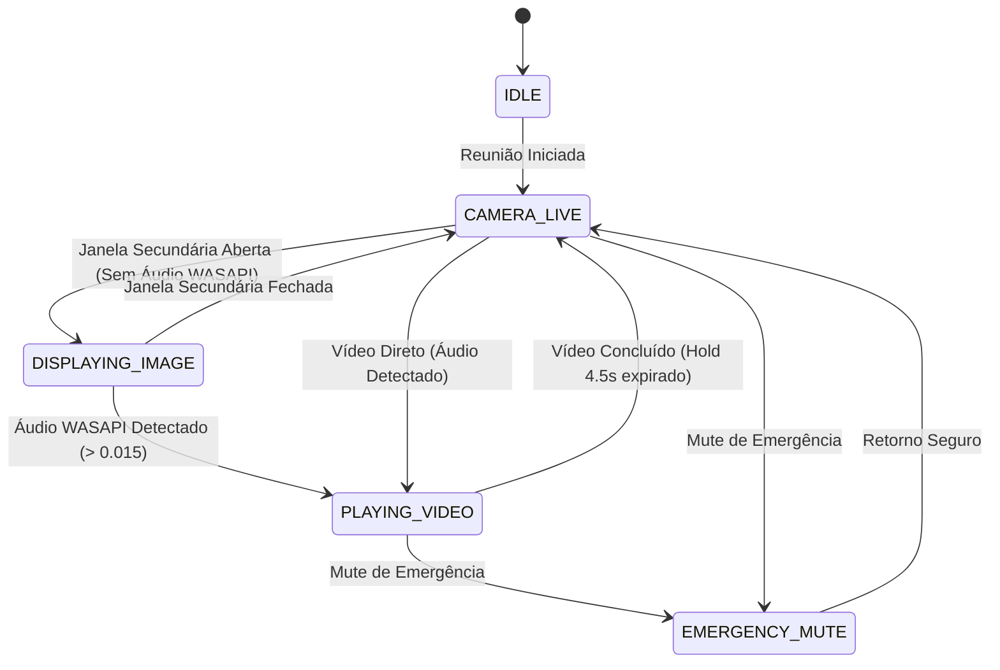

# Arquitetura v2-Hardened — Meeting Assistant

Este documento descreve a evolução arquitetural, estabilização e novos serviços introduzidos na iniciativa **v2-hardened** do `meeting-assistant`, mantendo 100% de retrocompatibilidade e aderência aos contratos históricos do Salão.

---

## 1. Diferenciação Automática Imagem vs. Vídeo (Máquina de Estados)

### O Problema
Em versões anteriores, a presença de qualquer mídia ou janela secundária no telão disparava automaticamente o muting do microfone do orador/assistência no OBS para evitar microfonia e vazamento. No entanto, reuniões frequentemente utilizam **imagens estáticas** (ilustrações da Sentinela, mapas bíblicos, gravuras, textos) durante as quais o orador e a assistência continuam comentando ativamente. Mutar o microfone nessas ocasiões causava perda de fala e obrigava o operador a desmutar manualmente.

### A Solução Arquitetural
A nova máquina de estados (`MeetingStateMachine` em `src/meeting_assistant/services/state_machine.py`) opera com distinção estrita baseada em áudio real WASAPI:

- **`DISPLAYING_IMAGE`**: Disparado quando uma janela secundária de mídia é detectada na tela de projeção sem presença de sinal sonoro do player. O OBS projeta a mídia, mas o **microfone local permanece estritamente ATIVO (desmutado)** para comentários normais.
- **`PLAYING_VIDEO`**: Disparado assim que o medidor de pico de áudio do processo (`AudioService`) detecta atividade sonora real acima do limiar (`audio_trigger_threshold = 0.015`) por 2 leituras consecutivas (~200 ms). Neste momento, a cena de mídia é confirmada e o **microfone local é mutado suavemente** para prevenir microfonia com as caixas do Salão.
- **Fail-Safe de Saída (`emergency_restore_on_exit`)**: Ao encerrar o aplicativo (`closeEvent` da janela principal ou `atexit`), o microfone no OBS é restaurado imediatamente para o estado desmutado, garantindo que o orador nunca fique com o áudio travado no OBS se o assistente for fechado durante a exibição de um vídeo.

---

## 2. Áudio Inteligente WASAPI e Liberação Anti-Pausa Dramática

### Monitoramento de Sessões WASAPI (`AudioService`)
O `AudioService` executa em uma `QThread` dedicada isolada com `comtypes.CoInitialize()` e `CoUninitialize()` rigorosamente gerenciados em bloco `try/finally`. Utiliza a interface COM `IAudioMeterInformation.GetPeakValue()` para medir o volume exato gerado pelos processos de mídia configurados (`JWLibrary.exe`, `vlc.exe`, `MediaPlayer.exe`).

### Liberação Anti-Pausa Dramática (Release Hold de 4.5s)
Vídeos instrutivos contêm pausas dramáticas de silêncio de 1 a 3 segundos na narração ou transições musicais. Um algoritmo ingênuo que retornasse à câmera assim que o áudio atingisse zero causaria "picotamento" de câmera e microfone durante a fala de um personagem ou narrador.
O `AudioService` implementa:
1. **Attack Rápido:** 2 amostras consecutivas (~200 ms) confirmam início de áudio real.
2. **Release Inteligente:** Ao detectar silêncio (pico < 0.015), o timer de hold (`audio_silence_hold_seconds = 4.5s`) é iniciado.
3. Se qualquer pico de áudio ocorrer dentro do intervalo de 4.5s, o timer é imediatamente cancelado e a reprodução continua em `PLAYING_VIDEO` sem qualquer interrupção de cena ou áudio.
4. O retorno só é emitido após a expiração completa dos 4.5s de silêncio contínuo OU quando a janela secundária do player é comprovadamente fechada/minimizada.

---

## 3. Resolução de Janelas UWP (`ApplicationFrameHost.exe`)

### O Desafio UWP no Windows 10/11
O `JW Library` é empacotado como aplicativo UWP moderno. No Windows, suas janelas são hospedadas e envelopadas pelo processo genérico `ApplicationFrameHost.exe`.
Funções clássicas baseadas em `win32process.GetWindowThreadProcessId()` retornam o PID do `ApplicationFrameHost.exe` em vez de `JWLibrary.exe`.

### O Algoritmo de Resolução Real (`WindowManager.get_real_window_process`)
O `WindowManager` implementa a resolução de processo real inspecionando a hierarquia nativa:
1. Obtém o PID da janela de topo via `win32process.GetWindowThreadProcessId(hwnd)`.
2. Se o nome do processo associado for `"ApplicationFrameHost.exe"`, enumera todas as janelas filhas (`win32gui.EnumChildWindows`).
3. Localiza janelas com classe `"Windows.UI.Core.CoreWindow"` cujo PID pertença ao aplicativo real envelopado.
4. Extrai o caminho e nome real do executável (ex.: `"JWLibrary.exe"`).
Com essa técnica, `find_windows_by_executable("JWLibrary.exe")` localiza janelas Win32 clássicas e UWP com 100% de fidelidade.

---

## 4. Proteção da Tela Secundária e Posicionamento Multi-Monitor

### Proteção de Coordenadas
O projetor/auditório reside no monitor secundário. Para evitar que janelas de projeção saltem acidentalmente para o monitor do operador (ou que janelas de controle invadam a projeção da assistência), o `WindowManager` oferece:
- `get_monitors_info()`: Enumera monitores físicos e lógicos via `EnumDisplayMonitors` e `GetMonitorInfo`.
- `enforce_secondary_screen_protection()`: Fixa e valida o posicionamento da janela secundária nas coordenadas exatas da tela de projeção usando a flag `win32con.SWP_NOACTIVATE`. A flag `SWP_NOACTIVATE` é imperativa para nunca roubar o foco de teclado ou mouse do operador durante a condução da reunião.

---

## 5. Pre-Flight Check e Watchdog de Saúde AV

### Pre-Flight Check (`PreFlightChecker`)
Executa uma rotina de diagnóstico dos 5 pilares essenciais da transmissão antes do início da reunião:
1. **OBS Studio:** Verifica se o processo está em execução e o WebSocket v5 conectado.
2. **Câmera Virtual OBS:** Verifica se a câmera virtual está emitindo vídeo (com funcionalidade de auto-fix para ativá-la automaticamente caso esteja desligada).
3. **VB-Cable (Áudio Virtual):** Verifica se o dispositivo de áudio `CABLE` está presente e ativo no subsistema WASAPI.
4. **Segundo Monitor:** Verifica a detecção física do monitor secundário de projeção.
5. **Zoom Desktop:** Verifica se o cliente Zoom (`Zoom.exe`) está em execução para a transmissão remota.

O botão **"🔍 Checar Ambiente"** na barra de prévia da interface principal executa essa verificação sob demanda e exibe um relatório com recomendações práticas para o operador.

### Watchdog em Segundo Plano (`WatchdogService`)
Em segundo plano, o `WatchdogService` verifica periodicamente (a cada 3s) a integridade dos 4 pilares operacionais (WebSocket, Câmera Virtual, VB-Cable, Segundo Monitor). Em caso de reconexão de cabos HDMI ou reinicialização de serviços, emite o sinal `health_status_updated` para atualização transparente do status do sistema e reposicionamento protetivo de janelas.

---

## 6. Integração com a Interface Gráfica e Responsividade

Para atender aos rigorosos requisitos de layout do `Meeting Assistant`:
- **Crachá de Estado (`state_badge`):** Integrado no cabeçalho superior (`brand_row`). Exibe o estado operacional em tempo real (`● CÂMERA AO VIVO`, `● REPRODUZINDO VÍDEO (MIC FECHADO)`, `● EXIBINDO IMAGEM (MIC ABERTO)`, `● MUTE DE EMERGÊNCIA`, `● EM ESPERA`). No modo compacto (380px), oculta-se responsivamente para evitar qualquer scrollbar horizontal.
- **Botão Checar Ambiente (`btn_preflight`):** Compartilha a linha de controles com a pausa de prévia sem consumir qualquer espaço vertical adicional, preservando os 40px mínimos da prévia do OBS sob escala extrema de 2.0x (480px de altura total).
- **Mute de Emergência:** Ação rápida acessível pelo operador que corta áudio local, áudio de mídia e direciona o OBS para a cena segura imediatamente.
